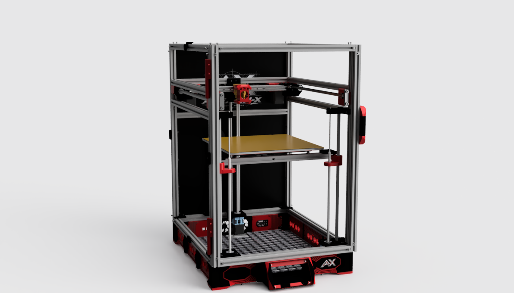

# Apexion-X

**CoreXY / Triple-Z** enclosed 3D printer. Its kinematics come from [RIFF220](https://github.com/itesdahl/RIFF220), the skirts are a remix of [TV06+](https://github.com/Terminal-Velocity-Collective/TV06_Plus), and the door and toolhead are the [Clicky-Clack Fridge Door](https://github.com/tanaes/whopping_Voron_mods/tree/main/clickyclacky_door) and [Dragon Burner](https://github.com/chirpy2605/voron/tree/main/V0/Dragon_Burner). See [Credits & license](#credits--license).

## Status: Rev 06A mechanical preview
Rev 06A is approved for a first mechanical fit-up. It uses three WobbleX WS8 stacks in the existing dowel seats and unbraced Ø10 × 468 mm Y rods.

The build manual is provisional, and the printer is not ready to build yet. Before you order or power on anything:
- Get the heater supplier to approve the cutout pattern before ordering a heater.
- Check the installed fastener and bearing stacks.
- Sweep the loaded bed through Z and tilt before setting firmware limits.
- Review the wiring, the protective devices and the Klipper configuration.

Production STLs and machine-specific firmware are not available yet. Choose and fit hardware from the [fit check](docs/design-reviews/2026-11-19-rev06a-mechanical-fit-check.md) and your own measurements.

## Key specs
These are design targets until a prototype has been measured. See the [Printer Specification](docs/Apexion-X%20Printer%20Specification.pdf).
- Build volume 299 × 310 × 356 mm
- 2020 extrusion frame: 25 pieces, about 12.4 m in total
- CoreXY with stacked belts (A at Z 34.5, B at Z 44.5) and about 1.95 m of GT2 per belt
- XY on Ø10 rods with LM10LUU bearings in the XY joints. X on a 345 mm MGN12 rail with an MGN12H carriage.
- Triple-Z on lead screws with Ø10 rods and LM10UU bearings. The bed sits kinematically on three WobbleX WS8 stacks (Rev 06A).
- Dragon Burner toolhead and BFI-style symmetric front idlers
- Enclosure panels cut to DXF by Mandala Rose Works
- v5 BOM counts: 138 printed parts, 316 screws, 134 T-nuts and 76 M3 heat-set inserts. Rev 06A changes some hardware; see the [BOM notes](bom/README.md).

## Look
- Black primary color with a red accent
- The [AX badge](docs/images/apexion-x-ax-emblem.png) goes on the right front skirt only. The left skirt is blank.
- The [Apexion-X logo](docs/images/apexion-x-logo.png) goes on the inside face of the rear panel.
- Each mark can be etched or applied as a sticker. The sticker is cheaper. Neither choice changes any part dimension.

## What's in this repo
| Path | Contents |
|---|---|
| [`cad/Apexion-X-Rev-06A.f3d`](cad/Apexion-X-Rev-06A.f3d) | Editable Fusion source (Rev 06A). Open it in Autodesk Fusion or upload it there. SHA-256 `d5ef0b1e3e074932542bbbcaf8950234348e8cf20a4cbbd005f501e615de129b` |
| [`docs/`](docs/README.md) | Build Manual Rev B.2 and Printer Specification PDFs, build notes, and the design history |
| [`docs/design-reviews/`](docs/design-reviews/) | Dated design checks, from the first TV06+ review to the Rev 06A fit check |
| [`bom/`](bom/README.md) | D3 BOM workbook (v5 baseline) and the Rev 06A hardware changes. Use them together for fit-up. |
| [`dxf/panels-mrw/`](dxf/panels-mrw/README.md) | Six cut profiles for the seven enclosure panels, with cutting notes. Confirm the door and electronics stock thickness. |

Coming later: `stl/` for production printed parts and `firmware/` for Klipper config and macros.

## Build documents
- [Build Manual, Rev B.2 (PDF)](docs/Apexion-X%20Build%20Manual.pdf). Its steps include the Rev 06A changes and Voron electrical references. The illustrations show the earlier v5 model. See the [Rev B notes](docs/build/2026-11-17-build-manual-revB.md).
- [Printer Specification (PDF)](docs/Apexion-X%20Printer%20Specification.pdf)
- [Rev 06A mechanical fit check](docs/design-reviews/2026-11-19-rev06a-mechanical-fit-check.md)
- [Design history](docs/README.md#design-history)

## Credits & license
Copyright © 2026 Flam723 for the Apexion-X contributions. The project's contributions are licensed under the [GNU General Public License, version 3](LICENSE) (GPL-3.0-only). The GPL permits commercial and noncommercial redistribution under its terms.

> Apexion-X by Flam723 · [project](./) · [GNU GPLv3](LICENSE) · Changes: [describe any changes].

Please credit Apexion-X by Flam723 and link to the project when posting a build.

Apexion-X preserves the copyright and license notices of the upstream projects below.

**TV06+ skirt design credit.** The Apexion-X skirts and front diffusers are a remix of [TV06+](https://github.com/Terminal-Velocity-Collective/TV06_Plus), designed by [VectorForce3D](https://github.com/VectorForce3D) and published by Terminal Velocity Collective. Apexion-X removes the original TV badge from the front diffusers and uses a separate left diffuser. [VectorForce3D approved GPLv3 redistribution of the adapted skirt geometry](https://github.com/Terminal-Velocity-Collective/TV06_Plus/issues/1#issuecomment-7044320758), including its use in the full Apexion-X printer assembly.

| Part of Apexion-X | Derived from | Author | Upstream license |
|---|---|---|---|
| Printer kinematics | [RIFF220](https://github.com/itesdahl/RIFF220) — itself a remix of the [Voron Trident](https://github.com/VoronDesign/Voron-Trident), BFI and Dragon Burner | V4projects ([itesdahl](https://github.com/itesdahl)) | GPL-3.0 ([LICENSE](https://github.com/itesdahl/RIFF220/blob/main/LICENSE)) |
| Skirts and front diffusers | [TV06+](https://github.com/Terminal-Velocity-Collective/TV06_Plus) | [VectorForce3D](https://github.com/VectorForce3D), published by Terminal Velocity Collective | [GPLv3 permission for the Apexion-X remix](https://github.com/Terminal-Velocity-Collective/TV06_Plus/issues/1#issuecomment-7044320758) |
| Electronics and wiring reference | [Voron Electrical Wiring](https://docs.vorondesign.com/build/electrical/index.html) and [Voron Trident](https://github.com/VoronDesign/Voron-Trident) | Voron Design and documentation contributors | [Trident GPL-3.0](https://github.com/VoronDesign/Voron-Trident/blob/main/LICENSE). The wiring guide is linked as a reference. |
| Door | [Clicky-Clack Fridge Door](https://github.com/tanaes/whopping_Voron_mods/tree/main/clickyclacky_door) | Jon Sanders ([tanaes](https://github.com/tanaes)) | GPL-3.0 ([LICENSE](https://github.com/tanaes/whopping_Voron_mods/blob/main/LICENSE)) |
| Toolhead | [Dragon Burner](https://github.com/chirpy2605/voron/tree/main/V0/Dragon_Burner) | chirpy ([chirpy2605](https://github.com/chirpy2605)) | GPL-3.0 ([LICENSE](https://github.com/chirpy2605/voron/blob/main/LICENSE)) |
| Front idlers | [Beefy Front Idlers for Trident](https://github.com/clee/VoronBFI) | clee | GPL-3.0 |
| WobbleX WS8 interfaces | [Interfaces for WobbleX integration](https://github.com/MirageC79/Interfaces-for-WobbleX-integration) | MirageC | GPL-3.0 |

Licensing notes (not legal advice):
- **RIFF220:** the kinematics were first noted as derived from "RIFF200"; the upstream design is the RIFF220 by V4projects.
- **GPLv3 contributions:** preserve upstream copyright and license notices, identify modifications, and make the corresponding editable CAD available when distributing covered exports or derived files.
